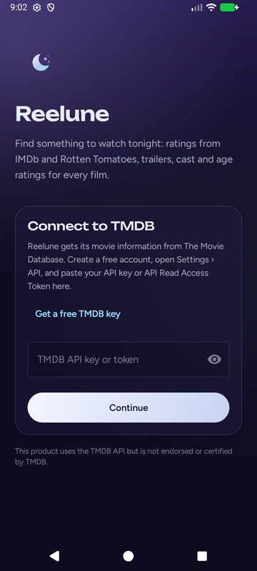

<p align="center">
  
</p>

<h1 align="center">Reelune for Android</h1>

<p align="center">
  A native Android movie guide: IMDb, Rotten Tomatoes and TMDB scores, age ratings, trailers and cast,<br />
  with year, language and genre filters. Built with Kotlin and Jetpack Compose.
</p>

<p align="center">
  
  
  
  
</p>

<p align="center"></p>

## Features

- **Opens straight to movies:** YTS is the default catalogue and needs no key. It includes IMDb ratings and US age ratings; year and language filters use YTS's public browse pages
- **Or use TMDB** (Settings → Movie data source): huge catalogue and age ratings for your country, with a free key
- **Browse:** trending films in a rotating featured carousel, then a poster grid that keeps loading as you scroll
- **Search** by title
- **Filters:** genre, release year (single years or decades), original language (100+), minimum rating, and sort by popularity, rating, release date, box office or title
- **Movie page:**
  - IMDb rating, Rotten Tomatoes and Metacritic scores (via OMDb) next to the TMDB score
  - **Age rating for your country**, for example U / UA / A in India or G / PG / PG-13 / R in the US, with what it means
  - YouTube trailer inside the app, and **View on IMDb**
  - Runtime, director, languages, cast and similar films
- **Plugins:** add-ons can add more ways to watch to a movie's page (see [Plugins](#plugins))
- Frosted-glass interface over each film's own artwork, with smooth transitions

## Install

1. Download `Reelune-<version>.apk` from [Releases](../../releases).
2. Open it on your phone and allow installing from your browser or file manager when Android asks.
3. Open Reelune. Movies load straight away from YTS; no account or key is needed.
4. Optional, in Settings:
   - Switch to **TMDB** with a free API key ([get one here](https://www.themoviedb.org/settings/api)). Both the short "API key" and the long "API Read Access Token" work.
   - Add a free **OMDb** key ([get one here](https://www.omdbapi.com/apikey.aspx)) for Rotten Tomatoes and Metacritic scores, plus IMDb ratings when using TMDB.

Keys are stored only on your phone.

## Plugins

Reelune can load plugins: `.reelune-plugin` files that add viewing sources to a movie's page. A plugin isn't an Android app and can't be installed through Android. You add it inside Reelune:

1. **Settings → Plugins → Add plugin from file**, and pick the `.reelune-plugin` file.
2. Reelune shows the plugin's name, version and **signing certificate fingerprint (SHA-256)**. Check it matches the one the plugin's author published, then tap **Add plugin**.
3. Updates must be signed with the same certificate, or Reelune refuses them. To switch to a plugin from a different signer, remove the old one first.

A plugin runs inside Reelune with the same access as the app. Only add plugins you trust.

### Writing a plugin

The whole contract is one file: [`plugin-api/.../ReelunePlugin.kt`](plugin-api/src/main/kotlin/io/github/niteshprasad/reelune/plugin/ReelunePlugin.kt) (API version **1**).

1. Create an Android application module. Its package name becomes the plugin's id.
2. Add the `plugin-api` sources as a **`compileOnly`** dependency. Reelune provides these classes at runtime, so don't bundle them.
3. Implement `ReelunePlugin` in a class with a public no-argument constructor:

   ```kotlin
   class MyPlugin : ReelunePlugin {
       override fun init(host: PluginHost) { /* keep host.cacheDir, host.dataDir, host::log */ }
       override fun findSources(movie: MovieRef): List<Source> = TODO("look up movie.imdbId / title / year")
       override fun openStream(source: Source): StreamSession = TODO("return an http://127.0.0.1 URL with Range support")
       override fun shutdown() {}
   }
   ```

4. Declare it in the plugin's `AndroidManifest.xml`:

   ```xml
   <application android:label="My plugin">
       <meta-data android:name="reelune.plugin.class" android:value="com.example.MyPlugin" />
       <meta-data android:name="reelune.plugin.api" android:value="1" />
       <meta-data android:name="reelune.plugin.name" android:value="My plugin" />
   </application>
   ```

5. Turn off minification (`isMinifyEnabled = false`), because Reelune finds the class by name. Always sign releases with the same key.
6. Add `android:testOnly="true"` to the `<application>` tag, so Android refuses to install the plugin as an app.
7. Distribute the signed release as `<Name>-<version>.reelune-plugin`. It's the same file as the APK with a different extension, which keeps Android's signature verification working while stopping it from looking like an app.

How Reelune runs a plugin:
- `findSources` and `openStream` are called off the main thread and may block.
- Exceptions are shown to the user as messages.
- Sources appear as rows on the movie page, with a play button (when `playable`) and buttons for `externalLinks`, which may be `https://` or `magnet:` URIs.
- The player is Media3 ExoPlayer. It reads `StreamSession.url` and `subtitles()`, polls `status()` every second, and calls `close()` when the viewer leaves.
- Native libraries in `lib/<abi>/` are supported: Reelune extracts the ones for the phone's CPU.

## Build from source

Requirements: Android Studio (or JDK 17+ and the Android SDK with platform 37.2).

```powershell
git clone https://github.com/nitesh-prasad/reelune-android.git
cd reelune-android
.\gradlew assembleDebug
```

The APK is written to `app/build/outputs/apk/debug/`.

**Release builds** are signed with the key described in `keystore.properties`. That file is git-ignored; see the format below. You can also supply the key through `REELUNE_KEYSTORE`, `REELUNE_KEYSTORE_PASSWORD`, `REELUNE_KEY_ALIAS` and `REELUNE_KEY_PASSWORD`:

```properties
storeFile=C:/path/to/reelune-app.jks
storePassword=…
keyAlias=reelune-app
keyPassword=…
```

```powershell
.\gradlew assembleRelease
```

**Plugin test:** [`PluginStreamTest`](app/src/androidTest/java/io/github/niteshprasad/reelune/PluginStreamTest.kt) loads a real plugin APK on a device or emulator, then checks adding it, finding sources, streaming a range, seeking and removing it. Copy a `.reelune-plugin` file into the app's cache before running it:

```powershell
adb push My-Plugin-1.0.0.reelune-plugin /data/local/tmp/test-plugin.apk
adb shell run-as io.github.niteshprasad.reelune cp /data/local/tmp/test-plugin.apk cache/test-plugin.apk
adb shell am instrument -w -e class io.github.niteshprasad.reelune.PluginStreamTest io.github.niteshprasad.reelune.test/androidx.test.runner.AndroidJUnitRunner
```

## Project layout

```
app/
  data/          Catalog interface with TMDB and YTS implementations, OMDb client, settings (DataStore)
  plugin/        PluginManager: verify, copy, extract native libs, load, remove
  ui/home/       Featured carousel, search, filter sheets, poster grid
  ui/details/    Movie page, scores, trailer dialog, plugin sources
  ui/settings/   Keys, age-rating country, plugins
  ui/player/     Media3 player for plugin streams
  ui/theme/      Colors, Unbounded + Figtree type, glass surfaces (Haze)
plugin-api/      The plugin contract (plain Kotlin/JVM)
```

**Built with:** Jetpack Compose (Material 3), Navigation, DataStore, Media3 ExoPlayer, OkHttp, kotlinx.serialization, jsoup, Coil 3, Haze, android-youtube-player.

## Credits

- Movie data and images: [TMDB](https://www.themoviedb.org) or [YTS](https://yts.gg/api), whichever you choose. *This product uses the TMDB API but is not endorsed or certified by TMDB.*
- Ratings: [OMDb API](https://www.omdbapi.com).
- Fonts: [Unbounded](https://fonts.google.com/specimen/Unbounded) and [Figtree](https://fonts.google.com/specimen/Figtree) (SIL Open Font License).

## License

[MIT](LICENSE)
